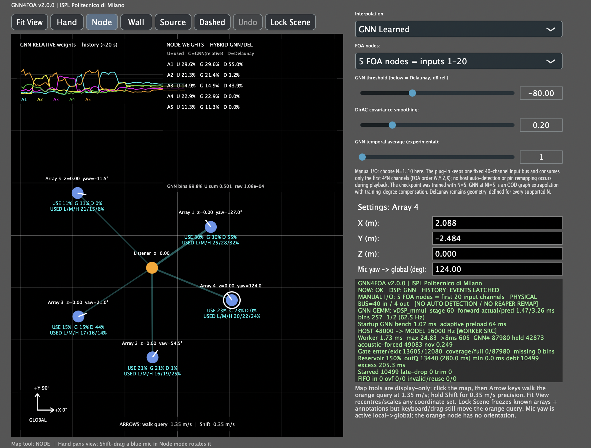
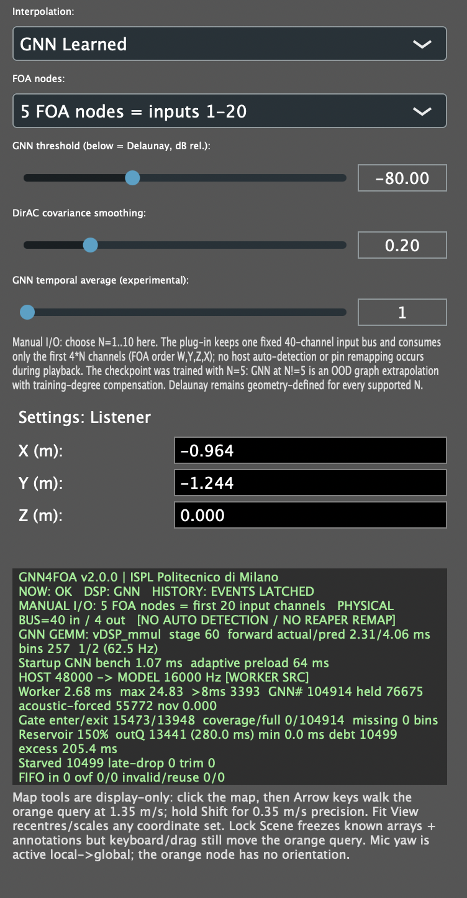

# Graphical interface

The GNN4FOA editor is a 1000 × 760 px interface with a spatial map on the left and controls/diagnostics on the right.

    

## Spatial map

Known microphone nodes are blue. The reconstructed/query node is orange. Coordinates are expressed in metres in a shared global frame.

The map also displays current node-weight links and a short history of recent relative weights. In GNN mode, the overlay exposes used, learned and Delaunay relative contributions; in Delaunay mode it shows the local geometric contribution.

### Tools

    

- **Fit View**: centres and scales the current scene.
- **Hand**: pans the map.
- **Node**: selects/moves microphone and query nodes.
- **Wall**: adds a line annotation.
- **Source**: adds a source marker annotation.
- **Dashed**: draws a dashed annotation.
- **Undo**: removes the latest annotation.
- **Lock Scene**: prevents edits to known microphones and annotations; the orange query remains movable.

Wall/source/dashed annotations are graphical only and are not published to the DSP.

### Navigation and editing

- Mouse wheel: zoom.
- Node mode + drag: move a node in X/Y.
- Shift + drag a blue microphone: change microphone yaw.
- Click the map, then Arrow keys: move the orange query at 1.35 m/s.
- Shift + Arrow keys: move at 0.35 m/s.
- Numeric X/Y/Z fields: precise coordinate entry.
- Microphone yaw field: precise local-to-global yaw in degrees.

The query node has position only and no orientation.

## Reconstruction controls
<table>
  <tr>
    <td width="50%" align="center">
      
    </td>
    <td width="50%" valign="middle">
      <h3>Interpolation</h3>
      
<code>Delaunay Baseline</code> selects the local paper-faithful DirAC/Delaunay path. <code>GNN Learned</code> selects the learned graph model.

      <h3>FOA nodes</h3>
      
Manual active node count from 1 to 5. This directly selects the first 4, 8, 12, 16 or 20 input channels. It is not inferred from track width or signal activity.

      <h3>GNN threshold</h3>
      
Relative energy threshold in dB. In GNN mode, bins below the threshold use the Delaunay reliability fallback. They are not muted.

      <h3>DirAC covariance smoothing</h3>
      
Recursive smoothing coefficient used when estimating spatial covariance statistics and the resulting energy/intensity/diffuseness descriptors.

      <h3>GNN temporal average</h3>
      
Optional averaging of learned weights across recent learned frames. A value of <code>1</code> disables additional multi-frame averaging.

      <h3>Diagnostics</h3>
      
The diagnostic panel reports runtime state including:.

      <ul>
        <li>host/model sample rates and resampling state;</li>
        <li>active node/input count;</li>
        <li>model worker timing and deadline counters;</li>
        <li>GNN forward timing and adaptive stride;</li>
        <li>acoustic novelty-triggered refreshes;</li>
        <li>output reservoir and FIFO state;</li>
        <li>learned raw/applied weight-sum statistics and clamp activity.</li>
      </ul>
     
These values are intended for runtime and performance inspection and do not change the reconstruction by themselves.

    </td>
  </tr>
</table>
